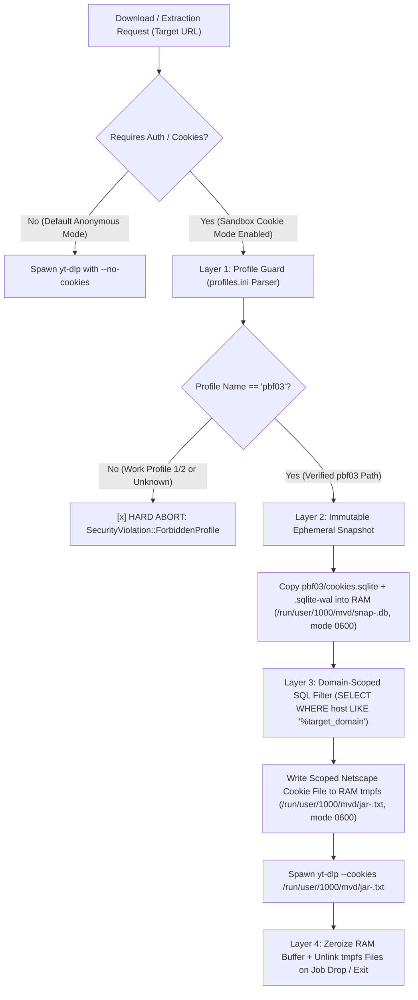

# Request for Comments (RFC): `mvd` Architecture, Kitty Graphics, `pbf03` Cookie Isolation & Offloaded CI/CD

| Metadata | Value |
| :--- | :--- |
| **RFC Number** | `RFC-0001` |
| **Title** | Technical Architecture, Rust Crate Stack, Ephemeral Sandbox Cookie Vault (`pbf03`), Expert MKV Pipeline & GitHub CI/CD |
| **Target Host** | Linux (`Wayland/KDE`, `kitty 0.50.0`, `yt-dlp 2026.10.26`, `ffmpeg n9.0.2`, `sqlite3`) |
| **Status** | `PROPOSED` |

---

## 1. Rust Library & Crate Stack (Specifically Tailored for Kitty Terminal)

To build a responsive, memory-safe, zero-bloat TUI on **Kitty `0.50.0`** running under **Wayland**, `mvd` selects the following production-proven Rust crates:

### 1.1 TUI & Kitty Graphics Layer
| Crate | Version | Role & Technical Justification for Kitty |
| :--- | :--- | :--- |
| **`ratatui`** | `0.29+` | Core immediate-mode TUI layout engine (`Block`, `Paragraph`, `Table`, `Scrollbar`, `Gauge`, `Clear` for centered float modals/popups). Combined with our **Dirty-Flag Renderer**, it draws only when state mutates. |
| **`crossterm`** | `0.28+` | Low-level terminal manipulation (raw mode, alternate screen, bracketed paste, `EventStream` async keyboard/resize events via `event-stream` feature). |
| **`ratatui-image`** | `4.0+` | **Primary Kitty Graphics Protocol Engine**. Communicates directly with Kitty (`\x1b_Ga=T,f=100,...`) to transmit PNG/RGBA pixel buffers directly to GPU terminal cells. Supports stateful `StatefulProtocol` resizing so thumbnails never flicker on scroll or layout resize. |
| **`image`** | `0.25+` | Fast in-memory decoding (`webp`, `jpeg`, `png` — YouTube/YT Music thumbnails are often `webp`), exact aspect-ratio probing (`width()`, `height()`), and Lanczos3/CatmullRom scaling before passing to Kitty. |
| **`rustix`** (or `libc`) | `0.38+` | Queries `ioctl(STDOUT_FILENO, TIOCGWINSZ)` to read exact terminal pixel dimensions (`ws_xpixel`, `ws_ypixel`, `ws_col`, `ws_row`) exposed by Kitty. This guarantees mathematically exact `16:9`, `1:1`, `9:16`, and `4:5` thumbnail bounding boxes without font-cell aspect distortion. |

### 1.2 Async Runtime, Networking & Subprocess Orchestration
| Crate | Version | Role & Technical Justification |
| :--- | :--- | :--- |
| **`tokio`** | `1.42+` | Multi-threaded async runtime (`rt-multi-thread`, `process`, `sync`, `fs`, `signal`, `time`). Drives `yt-dlp` and `ffmpeg` child processes asynchronously via `tokio::process::Command` without blocking the UI thread. |
| **`reqwest`** | `0.12+` | Async HTTP client (`rustls-tls`, `stream`, `json`, `gzip`). Used for: (1) high-speed concurrent HTTP Range chunk downloading, (2) downloading thumbnail bytes into memory/cache, and (3) querying `https://lrclib.net/api/get` for synced audio lyrics. |
| **`serde` / `serde_json` / `toml`** | `1.0+` / `0.8+` | Strongly-typed deserialization of `yt-dlp --dump-single-json` output, `ffprobe` stream inspection JSON, `lrclib` API payloads, and `$XDG_CONFIG_HOME/mvd/config.toml`. |
| **`url`** | `2.5+` | RFC-compliant URL parsing, host classification (`youtube.com`, `music.youtube.com`, `instagram.com`, `x.com`, `reddit.com`, `facebook.com`), and stripping tracking tokens (`si=`, `utm_*`). |

### 1.3 Security, Storage, XDG & System Integration
| Crate | Version | Role & Technical Justification |
| :--- | :--- | :--- |
| **`rusqlite`** | `0.32+` | Embedded SQLite engine (`bundled` or system `libsqlite3`). Used for: (1) `$XDG_DATA_HOME/mvd/history.db` (WAL mode) deduplication ledger, and (2) read-only immutable queries (`?mode=ro&immutable=1`) against Firefox `pbf03/cookies.sqlite`. |
| **`zeroize`** | `1.8+` | Cryptographic memory wiping (`Zeroize`, `ZeroizeOnDrop`). Ensures any in-memory cookie values read from `pbf03` are overwritten with `0x00` bytes in RAM immediately when dropped. |
| **`directories` / `xdg`** | `5.0+` | Strict XDG Base Directory resolution (`$XDG_CONFIG_HOME`, `$XDG_CACHE_HOME`, `$XDG_DATA_HOME`, `$XDG_STATE_HOME`, `$XDG_RUNTIME_DIR`). |
| **`arboard`** | `3.4+` | Cross-platform clipboard access with `features = ["wayland-data-control"]` so URL paste works natively on the user's KDE Wayland session. |
| **`lofty`** | `0.22+` | **Pure-Rust Audio Metadata & Lyrics Tagger** (supports `Opus`, `FLAC`, `M4A/MP4`, `MP3/ID3v2.4`, `Vorbis Comments`). Embeds `1:1` album art (`FRONT_COVER`), artist/album/track tags, and **synced `.lrc` lyrics (`SYLT` / `LYRICS` tag)** directly from Rust memory without installing external CLI taggers (`atomicparsley`, `mutagen`, `kid3`). |
| **`thiserror` & `color-eyre`** | `2.0+` / `0.6+` | Structured domain error enums (`MvdError`) and panic hooks that restore Kitty terminal state and wipe `/run/user/$UID/mvd/` before exiting. |

---

## 2. Deep-Dive Security Architecture: Firefox Multi-Profile Cookie Isolation (`pbf03`)

### 2.1 Threat Model & Problem Statement
The user maintains **3 Firefox profiles**:
- **Profile 1 & Profile 2 (`Work Profiles`)**: Contain sensitive corporate/work session tokens, SSO cookies, and personal identity. **Must NEVER be read, touched, listed, or leaked.**
- **Profile 3 (`pbf03` — Sandbox Profile)**: Used for untrusted web research, streaming (e.g., LK21), and anonymous browsing, configured with **Clear History/Cookies on Exit**.

**Key Security Risks to Mitigate**:
1. **Cross-Profile Leakage**: If a tool calls `yt-dlp --cookies-from-browser firefox` without strict profile validation, `yt-dlp` may default to `Default=1` in `profiles.ini` (which is often a Work profile!).
2. **Cross-Domain Sandbox Leakage**: Even inside `pbf03`, if the user has open tabs on `site-a.com` (e.g. LK21) and `youtube.com`, dumping the entire `pbf03` cookie jar into a Netscape `cookies.txt` file and handing it to an extractor for `site-b.com` exposes unrelated session cookies if HTTP redirects occur.
3. **SSD / Persistent Disk Residue**: Writing exported `cookies.txt` files to `/tmp` (if disk-backed) or `~/.cache` or `~/Downloads` leaves sensitive session tokens on non-volatile storage even after Firefox `pbf03` clears its cookies on exit.
4. **SQLite WAL Lock Contention**: Opening a live Firefox `cookies.sqlite` in read-write mode while Firefox is running can corrupt or lock the database, or fail to see uncommitted WAL frames (`cookies.sqlite-wal`).

### 2.2 Defense-in-Depth Architecture: The 4-Layer `pbf03` Cookie Vault



#### Layer 1: Compile-Time & Runtime Profile Guard (`ProfileGuard`)
- `mvd` parses `~/.mozilla/firefox/profiles.ini` in read-only mode.
- It locates the section where `Name=pbf03` (or `Path=...pbf03`).
- Any profile whose `Name != "pbf03"` is added to an explicit **Runtime Deny-List**.
- Furthermore, before opening the `pbf03` directory, `mvd` verifies canonical path resolution (`std::fs::canonicalize`) to prevent symlink traversal attacks pointing toward Work Profile 1 or Work Profile 2.

#### Layer 2: Live WAL-Safe RAM Snapshot (Respecting Firefox Clear-On-Exit)
- When Firefox is open in `pbf03`, active session cookies often reside in `cookies.sqlite-wal` (Write-Ahead Log) before checkpointing, especially when Firefox is configured to clear cookies on exit.
- To read live `pbf03` cookies without locking Firefox or touching the disk:
  1. `mvd` creates a restricted directory in RAM: `/run/user/1000/mvd/vault/` (`tmpfs`, permissions `0700`).
  2. It copies `cookies.sqlite`, `cookies.sqlite-wal`, and `cookies.sqlite-shm` (if present) from `pbf03` directly into `/run/user/1000/mvd/vault/snap-<job_uuid>.db` (`0600`).
  3. Because `/run/user/1000` is a Linux kernel `tmpfs` mount in RAM, **zero bytes are ever written to the SSD**.

#### Layer 3: Strict Domain-Scoped Cookie Extraction (Zero Cross-Site Leakage)
- Instead of exporting all cookies from `pbf03`, `mvd` queries the RAM snapshot with a strict parameterized SQL filter scoped **only** to the target URL's registrable domain (`eTLD+1`):
  ```sql
  SELECT host, isHttpOnly, path, isSecure, expiry, name, value
  FROM moz_cookies
  WHERE host = ?1 OR host = ?2 OR host LIKE ?3
  ```
  - *Example*: If downloading from `music.youtube.com`, only `.youtube.com` / `music.youtube.com` cookies (plus `google.com` auth only if explicitly toggled for YouTube login) are written into `/run/user/1000/mvd/vault/jar-<job_uuid>.txt`. Cookies from LK21 or other research sites in `pbf03` are **never** included in that job's cookie file.
- **Default Anonymous First**: By default, `mvd` runs in `[COOKIE: OFF (ANONYMOUS)]` or `[COOKIE: pbf03 ON-DEMAND]` mode — public YouTube/YouTube Music videos are extracted with `--no-cookies` first, and `pbf03` scoped cookies are injected only when toggled by the user (`C` key) or when an extractor returns an age-gate / anti-bot / session requirement.

#### Layer 4: Deterministic Zeroization & Crash Cleanup (`Drop` + Signal Hooks)
- All in-memory structs holding cookie strings implement `zeroize::ZeroizeOnDrop`.
- As soon as `yt-dlp` finishes metadata extraction or media download, the `EphemeralCookieGuard` RAII struct overwrites `/run/user/1000/mvd/vault/jar-<job_uuid>.txt` with zeros and calls `std::fs::remove_file`.
- On application startup and shutdown (including `SIGINT`, `SIGTERM`, `SIGHUP`, and Rust panic hooks), `mvd` sweeps and securely wipes `/run/user/1000/mvd/vault/`.

---

## 3. How `yt-dlp` + `ffmpeg` Work Together in `mvd`

### 3.1 Two-Phase Extraction & Download Pipeline

1. **Phase 1 — Non-Blocking Metadata & Stream Probe (`yt-dlp`)**:
   - For single URLs (`youtu.be/SPwyp2NG-bE`, `music.youtube.com/watch?v=...`):
     ```bash
     yt-dlp --dump-single-json --no-warnings --no-playlist --no-cookies <URL>
     ```
   - For playlists (`youtube.com/playlist?list=...`, `music.youtube.com/playlist?list=...`):
     ```bash
     yt-dlp --dump-single-json --flat-playlist --no-warnings --no-cookies <PLAYLIST_URL>
     ```
     This returns the full tracklist in `<1.5s` so the TUI renders immediately. As the user navigates items or queues them, background workers hydrate full format streams per video ID.

2. **Phase 2 — Granular Stream Acquisition & Expert MKV Muxing (`yt-dlp` + `ffmpeg n9.0.2`)**:
   - Remember from our System Bias Audit (**B1**): `ffmpeg n9.0.2` is installed, while `aria2c` and `mkvmerge` are not.
   - `mvd` orchestrates `yt-dlp` and `ffmpeg` in an isolated staging folder inside `~/Downloads/mvd/.staging/<job_uuid>/`:
     - **Video + Audio Stream Selection**: e.g., `-f "401+251/bestvideo+bestaudio"` (AV1 2160p + Opus 160k).
     - **Parallel Fragment Acceleration**: `--concurrent-fragments 4` (native multi-fragment downloader inside `yt-dlp`, or `mvd`'s native `reqwest` multi-range downloader for direct HTTP files).
     - **Subtitle Optimization (`EN` & `ID`)**:
       ```bash
       --write-subs --write-auto-subs --sub-langs "id,id-orig,en,en-orig,en-US,id-ID" --convert-subs srt
       ```
       Before invoking `ffmpeg`, `mvd`'s Rust Subtitle Optimizer inspects the downloaded `.srt` files:
       - If manual `id.srt` exists, it discards `id-orig.srt` (auto-generated) to avoid duplicate cluttered tracks.
       - If manual `en.srt` exists, it discards `en-orig.srt`.
       - It sanitizes overlapping ASR timestamp lines if auto-subs are used.
     - **Expert MKV Final Remux via `ffmpeg n9.0.2`**:
       ```bash
       ffmpeg -hide_banner -y \
         -i video.webm \
         -i audio.webm \
         -i sub_en.srt \
         -i sub_id.srt \
         -attach cover.jpg -metadata:s:t:0 mimetype=image/jpeg -metadata:s:t:0 filename=cover.jpg \
         -map 0:v:0 -map 1:a:0 -map 2:s:0 -map 3:s:0 \
         -c:v copy -c:a copy -c:s srt \
         -metadata:s:s:0 language=eng -metadata:s:s:0 title="English" -disposition:s:0 default \
         -metadata:s:s:1 language=ind -metadata:s:s:1 title="Indonesian" \
         -metadata title="Track/Video Title" \
         -metadata ARTIST="Channel/Artist" \
         "~/Downloads/mvd/Final_Output.mkv"
       ```
     - Zero re-encoding (`-c:v copy -c:a copy`) guarantees lossless quality and completes muxing in `<1 second` on NVMe storage.

### 3.2 MP4 vs. MKV Subtitle Handling (Internal Mux vs. External Sidecar `.srt`)
Based on empirical testing of `T-02` (`SPwyp2NG-bE`, where `en` is in `manual_subtitles` and `id` is in `automatic_captions`):
1. **Smart Per-Language Source Resolution**:
   - Before spawning the download worker, `mvd` inspects `info.subtitles` (manual) and `info.automatic_captions` (ASR) independently for `en` and `id`:
     - If `en` exists in `subtitles`, fetch manual `en`; else fallback to `automatic_captions["en"]`.
     - If `id` exists in `subtitles`, fetch manual `id`; else fallback to `automatic_captions["id"]`.
   - This avoids downloading redundant `en-auto` when manual `en` already exists, while still guaranteeing Indonesian (`id`) subtitles are captured even when only auto-captions exist!
2. **When Container = `.mkv` (Default Expert Mode)**:
   - Subtitles (`en.srt`, `id.srt` or `.ass`) are **muxed internally** into the `.mkv` container with ISO-639-2 language codes (`eng`, `ind`) and track titles (`English [Manual]`, `Indonesian [Auto]`), and the temporary `.srt` files in `.staging/` are removed so `~/Downloads/mvd/` remains clean (`1 video = 1 .mkv file`).
3. **When Container = `.mp4` (Compatibility / Sidecar Mode)**:
   - Because the MP4 container specification does not support raw `.srt`/`.ass` streams natively (only stripped-down `mov_text` / `tx3g`), `mvd` executes a **Dual Sidecar + Soft-Embed Policy** when `.mp4` is chosen:
     1. **External Sidecar `.srt` Files (Preserved in `~/Downloads/mvd/`)**:
        - Writes `Title [ID].en.srt` and `Title [ID].id.srt` directly alongside `Title [ID].mp4` (so external players, Smart TVs, and web players load full SubRip formatting automatically).
     2. **Optional Internal `mov_text` Stream**:
        - Also muxes `-c:s mov_text` tracks into the `.mp4` container so standalone players have built-in toggleable captions.

### 3.3 Spotify Bridge Architecture (`open.spotify.com` -> Metadata + LRCLIB + Duration-Scored Audio)
As proven in live test `T-07` (`https://open.spotify.com/track/7MtVPRGtZl6rPjMfLoI3Lh`):
- Direct `yt-dlp` extraction on `open.spotify.com` fails immediately with `ERROR: [DRM]`.
- `mvd` implements a zero-API-key **Spotify Native Resolver (`src/engine/spotify.rs`)**:
  1. Fetch `https://open.spotify.com/embed/track/<id>` (or `/album/<id>`, `/playlist/<id>`) and parse the embedded `__NEXT_DATA__` JSON (`props.pageProps.state.data.entity`).
  2. Extract canonical metadata: `title` (*"Fuck it I love you"*), `artists` (*["Lana Del Rey"]*), `duration_ms` (`218287` = `218.3s`), `release_date` (`2019-08-30`), and the high-resolution `1:1` cover art (`640x640` from `image-cdn-ak.spotifycdn.com`).
  3. Query `lrclib.net` with `(artist, title, duration=218)` -> retrieves exact synced lyrics (`[00:00.87] I like to see everything in neon...`).
  4. Resolve the audio stream via `yt-dlp --dump-single-json --flat-playlist "ytsearch5:<Artist> - <Title> audio"` and score each candidate by **Duration Proximity** ($\Delta t = |t_{\text{yt}} - t_{\text{spotify}}|$) + `- Topic` channel bonus.
     - In `T-07`, this automatically rejects the `560s` age-gated double music video (`LrSX_OcpeJg`, $\Delta t = 341.7\text{s}$) and selects the exact `219s` audio stream (`wDWE_Qp3oKM`, $\Delta t = 0.7\text{s}$)!
  5. Download the audio stream (`Opus 160k` / `FLAC`) and tag it in-memory using the **`lofty`** Rust crate with Spotify's official `1:1` cover art, release date, artist/album tags, and LRCLIB synced lyrics.

---

## 4. Smart Aspect-Ratio Thumbnail & LRCLIB Lyrics Engine

### 4.1 Terminal Cell Pixel Geometry Math (`Kitty 0.50.0`) & Native As-Is Thumbnail Selection
Live testing on `T-03`, `T-04`, `T-05`, and `T-06` revealed two critical nuances in `yt-dlp`'s `thumbnails[]` list on `music.youtube.com`:
1. **Nuance A — Pure Square Art Tracks (`5xx9gTEQaiQ`, "Love song")**:
   - The video stream resolution is `1080x1080` (`1:1`), and `thumbnails[]` contains true `1:1` square covers on `yt3.googleusercontent.com` (`226x226`, `302x302`, `544x544`), **but** `yt-dlp` assigns them `"preference": -39` while placing a pillarboxed `1280x720` (`hq720.jpg` with black sidebars, `"preference": -3`) at the end of the array!
   - **Rule**: When a track is a `1:1` Art Track (stream resolution is square `W == H`, or channel ends with ` - Topic`), `mvd` selects the highest-resolution `w == h` (`yt3.googleusercontent.com` / `i.scdn.co`) thumbnail so there are **never black pillarbox bars**.
2. **Nuance B — VEVO / Artist Music Videos & Community Uploads (`sgm3F5D1yz8`, `LrSX_OcpeJg`, `WHVupRkTdqo`)**:
   - Many tracks on `music.youtube.com` are official VEVO/Artist Music Videos (`1920x1080` `16:9`) or user video uploads (`CORBAL` `WHVupRkTdqo`) rather than square album art.
   - **Rule ("Apa Adanya / Native As-Is")**: `mvd` **never** force-crops a `16:9` VEVO/artist video thumbnail into `1:1`. If the underlying video stream is `16:9` (`1920x1080` / `1280x720`) or no square cover exists, `mvd` renders the **`16:9` thumbnail as-is** in the upper preview pane while still displaying the **LRCLIB Lyrics Preview** in the lower sub-pane!

Terminal character cells are rectangular (typically ~`10px` wide by `20px` tall, a `1:2` pixel ratio). If you place a `1:1` album cover into a `20x20` character grid without cell-ratio compensation, it stretches vertically into a `1:2` tall rectangle.

`mvd` solves this with exact pixel geometry:
1. Query Kitty via `TIOCGWINSZ` to obtain `cell_width_px = ws_xpixel / ws_col` and `cell_height_px = ws_ypixel / ws_row`.
2. Classify source aspect ratio ($R = W_{\text{img}} / H_{\text{img}}$):
   - **Square (`1:1`, $0.85 \le R \le 1.15$)**: `music.youtube.com`, Instagram square, album art.
   - **Landscape (`16:9`, $R > 1.15$)**: YouTube video (`youtu.be/SPwyp2NG-bE`), X/Twitter video, Reddit landscape.
   - **Vertical (`9:16`, $R < 0.65$)**: Instagram Reels, YouTube Shorts, TikTok.
   - **Portrait (`4:5` / `4:3`, $0.65 \le R < 0.85$)**: Instagram/Reddit/Facebook portrait media.
3. Given an available pane `Rect { width: cols, height: rows }`:
   - Compute available pixel box: $W_{\text{avail\_px}} = \text{cols} \times \text{cell\_width\_px}$, $H_{\text{avail\_px}} = \text{rows} \times \text{cell\_height\_px}$.
   - Fit image aspect ratio $R$ inside $(W_{\text{avail\_px}}, H_{\text{avail\_px}})$ to get target pixel dimensions $(W_{\text{fit\_px}}, H_{\text{fit\_px}})$.
   - Convert back to centered `Rect` cells:
     $$\text{target\_cols} = \left\lfloor \frac{W_{\text{fit\_px}}}{\text{cell\_width\_px}} \right\rfloor, \quad \text{target\_rows} = \left\lfloor \frac{H_{\text{fit\_px}}}{\text{cell\_height\_px}} \right\rfloor$$
   - Center `target_cols` and `target_rows` inside the Thumbnail Panel and pass that exact inner `Rect` to `ratatui-image`'s Kitty protocol renderer.

### 4.2 LRCLIB Lyrics Preview Pipeline (Underneath Thumbnail for Audio Sources)
When `is_audio_source(url, extractor)` is `true` (e.g., `music.youtube.com/watch?v=LrSX_OcpeJg`, `music.youtube.com/watch?v=5xx9gTEQaiQ`, or `OLAK5uy_...` album tracks):
1. **Pane Split**: The left preview column splits via `Layout::vertical([Constraint::Percentage(55), Constraint::Percentage(45)])`:
   - Top `55%`: Centered `1:1` Album Cover via Kitty Graphics Protocol.
   - Bottom `45%`: `─[ LYRICS : LRCLIB ]─` scrollable text widget.
2. **Metadata Sanitization for High Hit-Rate**:
   - Strip `" - Topic"` from `uploader`/`channel`.
   - Strip `"(Official Audio)"`, `"(Official Lyric Video)"`, `"[HD]"` from `title`.
   - Send async `GET https://lrclib.net/api/get?artist_name=...&track_name=...&album_name=...&duration=...` with `User-Agent: mvd/0.1.0 (https://github.com/porvata/mvd)`.
   - If `404`, immediately fallback to `GET https://lrclib.net/api/search?q=<artist> <track>` and pick the closest duration match ($\Delta t \le 3\text{s}$).
3. **Cache & Embed**:
   - Save result in `$XDG_CACHE_HOME/mvd/lyrics/<sha256>.json`.
   - Render synced timestamps `[mm:ss.xx]` in muted grey (`#888E99`) and lyric text in crisp white (`#ECEFF4`), with green accent (`#28b877`) scrollbar thumb.

---

## 5. Modular Project Structure (Strict Domain Separation: TUI vs. App State vs. Engine vs. Security)

To guarantee high maintainability, testability, and zero coupling between `ratatui` UI rendering and background download workers, `mvd` separates code into 7 bounded domain modules:

```text
/home/porvata/Projects/mvd/
├── AGENTS.md                        # Engineering standards, persona & strict rules
├── TODO                             # Quick status checklist
├── Cargo.toml                       # Dependencies, lints (deny unwrap/expect/unsafe)
├── rustfmt.toml                     # Strict formatting rules
├── clippy.toml                      # Strict clippy configuration
├── .github/
│   └── workflows/
│       ├── ci.yml                   # Offloaded fmt, clippy, unit tests, integration tests
│       └── release.yml              # Offloaded optimized LTO binary build & artifact upload
├── plan/
│   ├── PRD.md                       # Complete Product Requirements Document & Bias Matrix
│   ├── RFC.md                       # Technical Architecture, Kitty & pbf03 Cookie Security RFC
│   └── TODO.md                      # Detailed phased implementation plan
├── src/
│   ├── main.rs                      # Entrypoint, TUI -> CLI Handoff Coordinator, signal/panic hooks
│   ├── lib.rs                       # Library root exposing strictly-typed public modules
│   ├── domain/                      # PURE DOMAIN MODELS (Zero UI or I/O dependencies)
│   │   ├── mod.rs
│   │   ├── media.rs                 # MediaArchetype (SingleAudio, AudioPlaylist, SingleVideo, VideoPlaylist, StaticImage, AnimatedGif)
│   │   ├── metadata.rs              # EditableMetadata (Title, Artist, Album, Track#, Year, Genre, EXIF)
│   │   ├── playlist.rs              # PlaylistPolicy (Global Ceiling) + Per-Item Override (ItemOverride [*])
│   │   ├── subtitle.rs              # SubtitlePlan (EN/ID Manual vs Auto-ASR, MKV Internal vs MP4 Sidecar)
│   │   ├── queue_item.rs            # ResumableJobState, JobStatus, StagingPaths (.part / .ytdl resume)
│   │   └── error.rs                 # MvdError, Severity (Info [i], Warn [!], Error [x])
│   ├── config/
│   │   ├── mod.rs                   # XDG config loader/saver ($XDG_CONFIG_HOME/mvd/config.toml)
│   │   └── xdg.rs                   # XDG directory resolver ($XDG_DATA_HOME, $XDG_STATE_HOME, $XDG_CACHE_HOME, $XDG_RUNTIME_DIR)
│   ├── app/                         # THE ELM ARCHITECTURE (TEA) STATE MACHINE
│   │   ├── mod.rs
│   │   ├── model.rs                 # AppModel (ActivePage, PreviewCondition, QueueState, ModalStack, PrivacyMode, dirty flag)
│   │   ├── message.rs               # Message enum (KeyEvents, WorkerTelemetry, CliDetachRequest)
│   │   ├── command.rs               # Side-effect Command descriptors dispatched by update()
│   │   ├── update.rs                # Pure deterministic transition: fn update(&mut AppModel, Message) -> Vec<Command>
│   │   └── keymap.rs                # Conditional Key Resolver (Q vs q, Ctrl+C, Esc, c, m, f, p, n, D, I)
│   ├── ui/                          # RATATUI VIEW LAYER (Pure Rendering, Zero Business Logic)
│   │   ├── mod.rs
│   │   ├── view.rs                  # Dirty-flag root renderer
│   │   ├── theme.rs                 # Sharp BorderType::Plain, Centered Token helper, JetBrains Mono symbols, #28b877 accent
│   │   ├── aspect.rs                # TIOCGWINSZ Kitty pixel math & Native As-Is vs 1:1 Art Track calculator
│   │   ├── layout.rs                # Conditional Left-Preview + Right-Inspector 6-Archetype layout builder
│   │   ├── components/
│   │   │   ├── mod.rs
│   │   │   ├── panel.rs             # Sharp-cornered thin border Block builder with centered ─[ TITLE ]─ token
│   │   │   ├── topbar.rs            # Header, tabs, pbf03 lock badge, Privacy [I] badge, speed & cache status
│   │   │   ├── footer.rs            # Conditional action hints (strictly omits default j/k & Esc)
│   │   │   ├── thumbnail.rs         # Kitty Graphics Protocol preview widget (Video, Art, Image Gallery, GIF)
│   │   │   ├── lyrics.rs            # LRCLIB lyrics sub-pane below thumbnail
│   │   │   ├── modal.rs             # Centered float dialogs (Detach Confirm, Metadata Editor, Item Override, Quick Enqueue)
│   │   │   ├── skeleton.rs          # Utilitarian skeleton loading placeholders
│   │   │   └── scrollbar.rs         # Styled utilitarian scrollbar
│   │   └── pages/
│   │       ├── mod.rs
│   │       ├── extractor.rs         # Page [1]: Conditional 6-archetype Left Preview + Right Inspector/Playlist Table
│   │       ├── queue.rs             # Page [2]: Dedicated Concurrent Queue Manager page
│   │       ├── logs.rs              # Page [3]: Raw yt-dlp + ffmpeg stdout/stderr & event ledger (with non-destructive clear)
│   │       ├── history.rs           # Page [4]: SQLite History Ledger (with non-destructive DB purge)
│   │       └── settings.rs          # Page [5]: XDG paths, pbf03 guard status, EN/ID subs, cache purge
│   ├── cli/                         # HEADLESS CLI PROGRESS HANDOFF ENGINE
│   │   ├── mod.rs
│   │   └── progress_runner.rs       # Takes over when user presses 'Q' in TUI; handles Ctrl+C graceful state flush
│   ├── engine/                      # ASYNC MEDIA EXTRACTION & POST-PROCESSING WORKERS
│   │   ├── mod.rs
│   │   ├── parser.rs                # Multi-site URL normalizer (YT, YT Music, Spotify, X, Reddit, IG, FB, Pinterest, Adult/HLS)
│   │   ├── ytdlp.rs                 # Async yt-dlp JSON extractor & resumable (--continue) fragment spawner
│   │   ├── spotify.rs               # Zero-key Spotify Embed JSON + Duration-Scored YT Music Audio Bridge
│   │   ├── media_fallback.rs        # OpenGraph / Direct CDN High-Res Image & GIF extractor (Pinterest, IG, X)
│   │   ├── ffmpeg.rs                # Expert MKV muxer, MP4 sidecar + mov_text muxer, GIF/WebM remuxer
│   │   ├── tagger.rs                # Pure-Rust 'lofty' audio/video metadata & synced LRC tag writer
│   │   ├── lrclib.rs                # Async LRCLIB client, title cleaner, synced/plain parser
│   │   └── queue_worker.rs          # Multi-worker Tokio semaphore queue, transactional state persistence, pause/resume
│   ├── security/
│   │   ├── mod.rs
│   │   ├── profile_guard.rs         # Firefox profiles.ini parser & hard 'pbf03' allowlist enforcer
│   │   └── cookie_vault.rs          # RAM tmpfs (/run/user/$UID/mvd) domain-scoped cookie extractor + Zeroize
│   └── storage/
│       ├── mod.rs
│       ├── ledger.rs                # SQLite WAL history & duplicate detection (non-destructive clear only)
│       ├── state_store.rs           # Persistent $XDG_STATE_HOME/mvd/queue.json for crash/Ctrl+C resume
│       └── cache.rs                 # Bounded 256 MiB LRU + TTL cache eviction (bypassed in Ephemeral Privacy Mode)
└── tests/
    ├── url_parser_tests.rs          # Tests all 7 user-provided URLs + X, Reddit, IG, Pinterest, FB
    ├── cookie_isolation_tests.rs    # Verifies work profiles are blocked & pbf03 tmpfs zeroization
    ├── playlist_override_tests.rs   # Verifies Global Policy + Per-Item Override [*] resolution & resume state
    ├── aspect_ratio_tests.rs        # Tests 16:9 VEVO vs 1:1 Art Track, 9:16, 4:5, 2:3 cell geometry math
    └── subtitle_mkv_mp4_tests.rs    # Tests EN/ID Manual+Auto deduplication, MKV muxing & MP4 sidecar .srt generation
```

---

## 6. Offloaded GitHub Actions CI/CD Architecture (Zero Laptop Load)

To respect the rule **"test dan kompilasi di lakukan di github bukan di laptop saya untuk mengurangi beban"**, the local workstation only edits source files and pushes commits to GitHub.

### 6.1 `.github/workflows/ci.yml` Pipeline Design
1. **Trigger**: `push` and `pull_request` on `main` / `feat/*`, plus `workflow_dispatch`.
2. **Jobs (Running on `ubuntu-latest` GitHub Runners)**:
   - **`lint-and-format`**:
     - Runs `cargo fmt --all -- --check`
     - Runs `cargo clippy --all-targets --all-features -- -D warnings -D clippy::unwrap_used -D clippy::expect_used`
   - **`unit-and-security-tests`**:
     - Uses `Swatinem/rust-cache@v2` for fast caching.
     - Runs `cargo test --lib --tests`:
       - Verifies URL parsing & tracking-parameter stripping on all **6 Test Links** (`T-01` through `T-06`).
       - Verifies `ProfileGuard` hard-rejects synthetic Firefox work profiles (`work-01`, `work-02`, `default-release`) and only accepts `pbf03`.
       - Verifies `CookieVault` extracts only domain-matching rows into `tmpfs` with `0600` mode and zeroizes on drop.
       - Verifies `SubtitleOptimizer` prioritizes `id` and `en` manual tracks over ASR tracks and constructs lossless `ffmpeg` `.mkv` remux arguments.
   - **`live-extractor-smoke-test`** (`workflow_dispatch` / scheduled):
     - Installs latest `yt-dlp` and `ffmpeg` on the GitHub runner.
     - Executes `mvd --headless-verify-urls` against the 6 test links (`T-01..T-06`) and `lrclib.net` API to verify live metadata extraction and lyrics matching in CI.
   - **`release-binary-artifact`**:
     - Compiles `cargo build --release` (`lto = "thin"`, `strip = "symbols"`, `codegen-units = 1`) on GitHub's servers and uploads the ready-to-run `mvd-x86_64-unknown-linux-gnu` binary artifact so the user can simply download the pre-compiled ~6 MB binary without ever compiling on their laptop.
